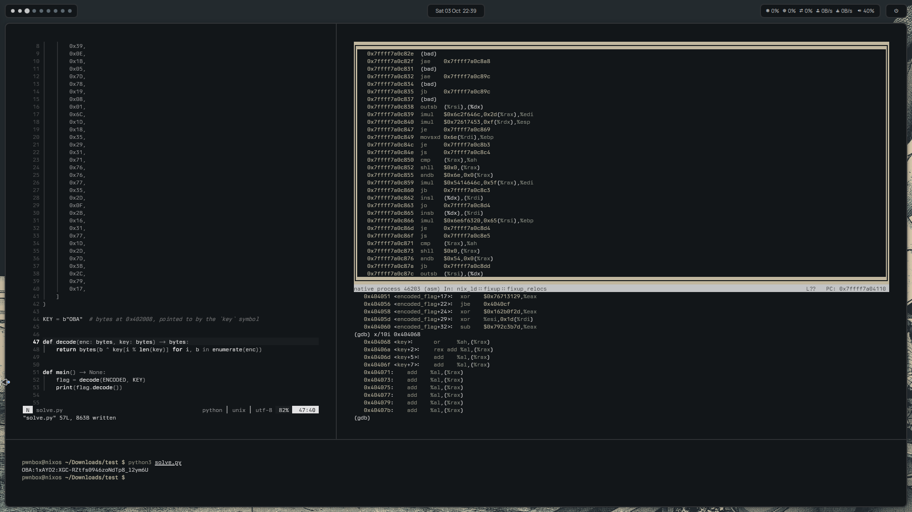

<h1 align="center">PWNBOX</h1>

<p align="center">
  
</p>

<p align="center">
  A ready-to-go <a href="https://nixos.org">NixOS</a> +
  <a href="https://github.com/nix-community/home-manager">home-manager</a> box for
  <b>hacking, reverse engineering, Active Directory and networking</b>.
  It's reproducible, portable and built for <b>privacy</b>.
</p>

---

## Table of contents

- [Documentation](#documentation)
- [Categories](#categories)
- [Apps](#apps)
- [Themes & customization](#themes--customization)
- [Desktop](#desktop)
- [Keybinds](#keybinds)
- [Privacy](#privacy)
- [Install](#install)

---

## Documentation

The full manual lives in [`docs/`](docs/README.md):

| Document | What it covers |
| --- | --- |
| [Getting started](docs/getting-started.md) | Install, first boot, updates, host config |
| [Desktop](docs/desktop.md) | Hyprland, GNOME, Quickshell and the bar |
| [Keybinds](docs/keybinds.md) | Every keyboard shortcut |
| [Themes](docs/themes.md) | Wallpaper themes, custom themes, the `ALT + S` menu |
| [Fonts](docs/fonts.md) | System/application fonts and sizes |
| [Apps](docs/apps.md) | Per-app theming and live updates |
| [Packages](docs/packages.md) | Tool categories and optional app sets |
| [Privacy](docs/privacy.md) | Hardening and zero-trace defaults |
| [Architecture](docs/architecture.md) | Repo layout and how a theme switch works |
| [Troubleshooting](docs/troubleshooting.md) | Common problems and fixes |
| [Development](docs/development.md) | Add themes, packages and bar styles |

---

## Categories

26 pentest categories, all on by default. Turn any of them off with
`pwnbox.packages.toolset.<category>.enable = false;`.

| Group | Category | Focus |
| --- | --- | --- |
| **Recon & Web** | `reconnaissance` | Host/port discovery, DNS, OSINT |
| | `web` | Web proxies, injection, content discovery |
| **Exploit & AD** | `exploitation` | Exploit frameworks and databases |
| | `active-directory` | Windows / AD attack & enumeration |
| **Network & Radio** | `network` | Capture, MITM, proxying, pivoting |
| | `wireless` | Wi-Fi auditing |
| | `bluetooth` | Bluetooth / BLE |
| | `rf-sdr` | Radio / software-defined radio |
| **Hardware & Firmware** | `hardware` | Embedded, flashing, logic |
| | `firmware` | Firmware extraction & analysis |
| | `smartcards` | NFC, RFID, smart cards |
| **Reversing & Pwn** | `reverse-engineering` | Disassembly, decompilation, malware |
| | `binary-exploitation` | Pwn, debugging, ROP |
| | `fuzzing` | Fuzzers and mutation tooling |
| **Forensics & Defense** | `forensics` | Disk & memory forensics |
| | `blue-team` | Detection, monitoring, hardening |
| | `code-analysis` | SAST, secrets, dependencies |
| **Cloud & Infra** | `cloud` | AWS, Azure, GCP |
| | `containers` | Docker, Podman |
| | `kubernetes` | Kubernetes tooling |
| **Cracking & Crypto** | `password-cracking` | Hash & login cracking |
| | `cryptography` | Crypto and key tooling |
| | `wordlists` | Bundled wordlists |
| **Mobile & Comms** | `mobile` | Android / iOS |
| | `voip` | SIP |
| **Utilities** | `python` | OSINT CLI helpers |

## Apps

On top of the toolset, the box ships a full daily-driver app set:

| Area | Apps |
| --- | --- |
| **Private & encrypted chat** | Signal, SimpleX, Element (Matrix), Dino (XMPP), qTox, AyuGram (Telegram), Equibop (Discord / Equicord) |
| **Browsers** | Zen (default), Chromium, Tor Browser |
| **Privacy & security** | KeePassXC, Mullvad VPN, Tor + torsocks |
| **Office & notes** | LibreOffice, Obsidian, Geary, Zathura |
| **Media & creative** | Spotify, VLC, mpv, cmus, qBittorrent, GIMP, Inkscape, Krita, OBS, Audacity, Kdenlive, Blender |
| **Terminal & system** | kitty, ranger, zsh + oh-my-zsh, tmux, btop, fastfetch, fzf, ripgrep, bat, eza, zoxide |
| **Development** | Neovim, Zed, Git, Docker / Podman, libvirt / KVM and language toolchains (C/C++, Rust, Go, Python, JVM, JS/TS, Haskell and many more) |

Optional sets. Turn them on with `pwnbox.packages.gaming` or
`pwnbox.packages.creative`.

## Themes & customization

- **Wallpaper-driven themes.** The palette is pulled from your wallpaper and
  applied everywhere: bar, terminal, launcher, notifications, editor, GTK apps,
  chat clients, Spotify and more.
- **Wallpaper library.** All wallpapers live in the flake at
  `dotfiles/gnome/wallpapers/` (linked read-only to
  `~/.local/share/pwnbox/wallpapers`). Add an image there and rebuild; the
  picker reads that folder. Custom themes keep their own wallpaper next to
  their `theme.conf`.
- **Custom themes.** Fixed-palette themes live in `dotfiles/themes/<name>/`,
  each with its own `theme.conf` and wallpaper.
- **One menu for everything.** `ALT + S` opens the settings picker for theme,
  wallpaper, bar style, corner radii, fonts, font sizes, blur, transparency and
  animations. See [docs/themes.md](docs/themes.md).
- **Live app theming.** Spotify, Discord (Equibop) and Telegram (AyuGram)
  update while they are running, without quitting them. OBS Studio and Zen
  follow the theme the next time they start. See [docs/apps.md](docs/apps.md).
- All appearance choices are saved and re-applied on login.

## Desktop

Hyprland is the default session, with GNOME kept as a second choice at login.
The bar, notifications and power menu are built with Quickshell, and Neovim is
configured VS Code-style with everything provided by Nix (nothing is downloaded
at runtime).

## Keybinds

| Keys | Action |
| --- | --- |
| `CTRL + SPACE` | App launcher |
| `CTRL + ENTER` | Terminal |
| `ALT + D` / `F` / `M` | Discord / Zen / Music |
| `ALT + S` | Theme & settings menu |
| `ALT + E` | Emoji picker |
| `ALT + {1-9}` | Switch workspace |
| `SUPER + {1-9}` | Move window to workspace |
| `ALT + arrows` | Focus window |
| `ALT + SHIFT + arrows` | Move window (tiled) |
| `SUPER + SHIFT + arrows` | Nudge floating window |
| `SUPER + CTRL + arrows` | Resize window |
| `SUPER + T` / `P` / `V` | Float / pseudo-tile / toggle split |
| `SUPER + F` / `SHIFT + F` | Fullscreen / real fullscreen |
| `ALT + Z` | Close window (apps like Discord may keep running in the background) |
| `ALT + SHIFT + Q` | Quit the program (ends it completely) |
| `SUPER + L` | Lock screen |
| `SUPER + ESCAPE` | Power menu |
| `SUPER + \`` | Clipboard history |
| `SUPER + SHIFT + S` / `PRINT` / `SUPER + SHIFT + R` | Region / full / saved screenshot |
| `ALT + TAB` | Window switcher with live previews (hold ALT, tap TAB, release; add SHIFT to go back) |
| `CTRL + ALT + ←/→` | Previous / next workspace |

## Privacy

Privacy and messaging apps are installed by default, and the system is hardened
to keep no traces:

- No logs. Volatile journald, `/var/log` on a RAM disk.
- No on-disk swap. zram only, so nothing plaintext touches disk.
- RAM-backed `/tmp` and `/var/tmp`.
- Hardened kernel & network, `sudo-rs`, locked root, firewall on.
- No persisted shell history.
- Signal, SimpleX, Element, Dino, qTox, Tor Browser and Mullvad included.

## Install

On an existing NixOS machine:

```bash
./install.sh switch
```

The installer detects your user, host and hardware, creates the host config,
then activates. Other actions: `build`, `test`, `boot`, `dry-activate`.

Useful commands after install:

| Command | Does |
| --- | --- |
| `./install.sh switch` | Rebuild and activate |
| `upd` | Rebuild and activate |
| `update` | Update all flake inputs, then rebuild |
| `ALT + S` | Open the theme / settings menu |

Add your own packages in `pkgs/custom.nix`.
